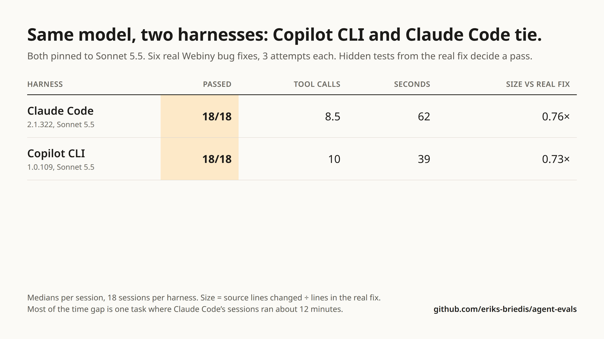
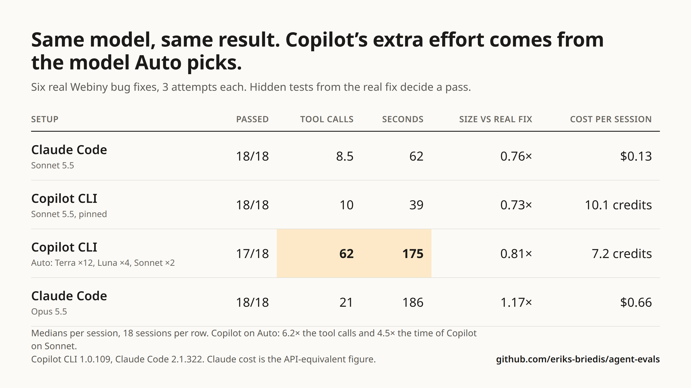
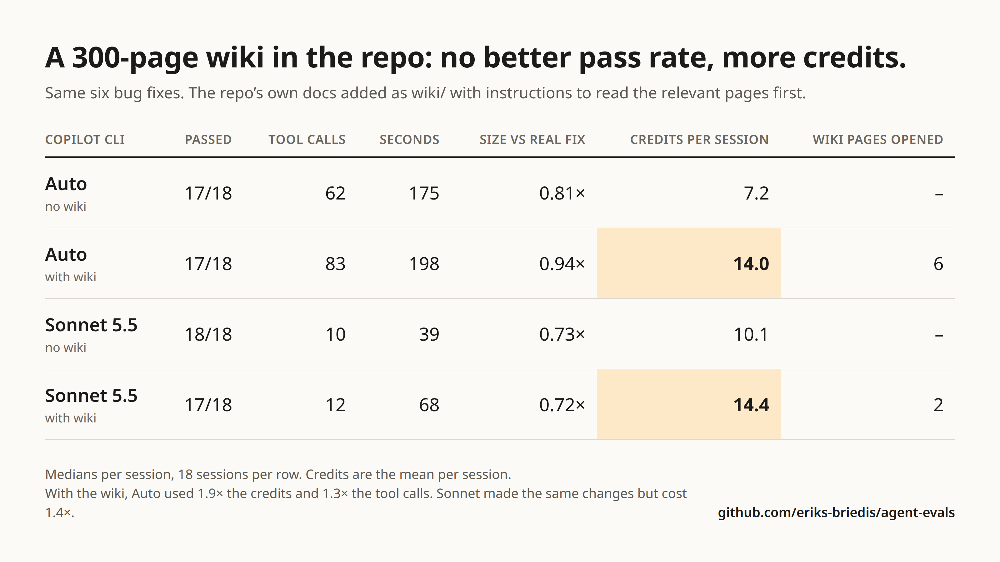
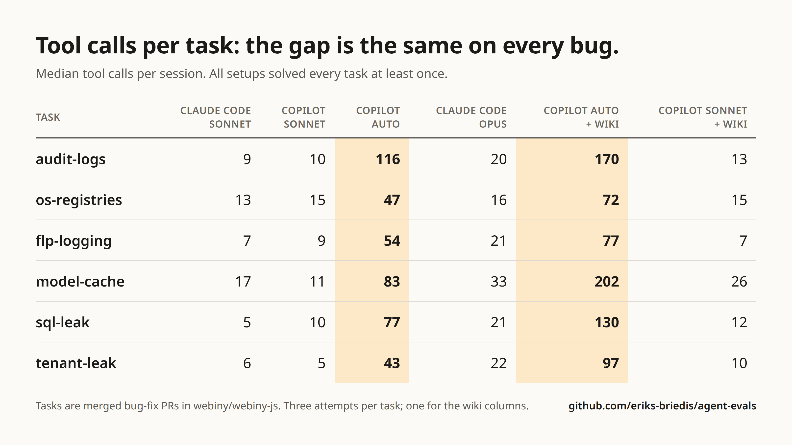

# Experiment: Copilot CLI vs Claude Code on real Webiny bug fixes

November 2026. 84 agent sessions on six real bug fixes from [webiny/webiny-js](https://github.com/webiny/webiny-js), run with the harness in this repo's parent experiment. Per-session data: [`sessions.csv`](sessions.csv). The code each agent wrote: [`patches/`](patches/).

## Question

Copilot CLI often spends far more effort than a task needs. Is that the harness (prompts, tools, subagents), the model, or the amount of documentation in the repo?

## Method

- **Tasks:** six merged bug-fix PRs. The agent gets the repo at the commit before the fix, already installed and built, plus a ticket describing the symptoms.
- **Grading:** the tests from the real fix are hidden from the agent and run afterwards. A session passes when those tests pass and the change stays within size limits relative to the real fix.
- **Size:** source lines the agent changed divided by the lines in the real fix. Tests and markdown are not counted.
- **Context:** all agent instruction files (`AGENTS.md`, `CLAUDE.md`, skills, MCP config, `ai-context/`) were removed from the repo, except in the wiki rows.
- **Runs:** non-interactive, one session per attempt, three attempts per task. The wiki rows have one attempt per task.
- **Versions:** GitHub Copilot CLI 1.0.109, Claude Code 2.1.322.

## Results without a wiki

Medians per session, 18 sessions per row.

| Row | Agent | Model | Pass | Tool calls | Seconds | Size vs real fix | Sessions touching extra files | Cost per session |
|---|---|---|---|---|---|---|---|---|
| A | Claude Code | Sonnet 5.5 | 18/18 | 8.5 | 62 | 0.76× | 5 | $0.13 |
| B | Copilot CLI | Sonnet 5.5, pinned | 18/18 | 10 | 39 | 0.73× | 2 | 10.1 credits |
| C | Copilot CLI | Auto | 17/18 | 62 | 175 | 0.81× | 10 | 7.2 credits |
| D | Claude Code | Opus 5.5 | 18/18 | 21 | 186 | 1.17× | 10 | $0.66 |

"Extra files" means source files changed that the real fix did not touch. Claude Code cost is the API-equivalent figure the CLI reports; Copilot cost is AI credits.

In row C, Auto picked `gpt-6.1-terra` in 12 sessions, `gpt-6-luna` in 4 and `claude-sonnet-5.5` in 2.

### What it shows

- **Same model, different harness (A vs B):** no meaningful difference in pass rate, effort or change size.
- **Same harness, Auto vs pinned Sonnet (C vs B):** about 6× the tool calls and 4.5× the time for the same pass rate, and five times as many sessions touching files outside the real fix.
- **Bigger model (D vs A):** Opus took three times as long and wrote larger changes, with no gain in pass rate on these tasks.
- **The one failure:** a row C session whose fix was correct but 5.8× the size of the real one (limit 5×).

## Results with a wiki

Each workspace got a `wiki/` folder holding Webiny's own markdown docs from that commit (about 300 pages, 4 MB) and an [`AGENTS.md`](wiki-AGENTS.md) telling the agent to read the relevant pages before changing code. Tickets were unchanged. Six sessions per wiki row.

| Row | Model | Wiki | Pass | Tool calls | Seconds | Size vs real fix | Credits per session | Wiki pages opened |
|---|---|---|---|---|---|---|---|---|
| C | Auto | no | 17/18 | 62 | 175 | 0.81× | 7.2 | n/a |
| E | Auto | yes | 6/6 | 113.5 | 430 | 1.07× | 21.1 | 5.5 (75 KB) |
| B | Sonnet 5.5 | no | 18/18 | 10 | 39 | 0.73× | 10.1 | n/a |
| F | Sonnet 5.5 | yes | 6/6 | 12.5 | 65 | 0.68× | 17.4 | 2.5 (17 KB) |

In row E, Auto picked `gpt-6.1-terra` in 4 sessions and `gpt-6-luna` in 2.

### What it shows

- **Auto with a wiki:** about 1.8× the tool calls, 2.5× the time and 2.9× the credits. Changes were somewhat larger.
- **Sonnet with a wiki:** behaviour barely changed, but credits rose about 70%.
- **Instructions:** all 12 sessions followed the instruction file's rule about the final message and none committed, as the ticket required. Nothing here shows the agent following its prompt less.

## Per task

Pass count, then median tool calls.

| Task | A: Claude Code, Sonnet | B: Copilot, Sonnet | C: Copilot, Auto | D: Claude Code, Opus | E: Copilot, Auto, wiki | F: Copilot, Sonnet, wiki |
|---|---|---|---|---|---|---|
| audit-logs | 3/3, 9 | 3/3, 10 | 2/3, 116 | 3/3, 20 | 1/1, 170 | 1/1, 13 |
| os-registries | 3/3, 13 | 3/3, 15 | 3/3, 47 | 3/3, 16 | 1/1, 72 | 1/1, 15 |
| flp-logging | 3/3, 7 | 3/3, 9 | 3/3, 54 | 3/3, 21 | 1/1, 77 | 1/1, 7 |
| model-cache | 3/3, 17 | 3/3, 11 | 3/3, 83 | 3/3, 33 | 1/1, 202 | 1/1, 26 |
| sql-leak | 3/3, 5 | 3/3, 10 | 3/3, 77 | 3/3, 21 | 1/1, 130 | 1/1, 12 |
| tenant-leak | 3/3, 6 | 3/3, 5 | 3/3, 43 | 3/3, 22 | 1/1, 97 | 1/1, 10 |

The images are generated from `sessions.csv` by [`make-images.mjs`](make-images.mjs).

## Limits

- **Ceiling:** every row passes 17 or 18 of 18 (6 of 6 in the wiki rows), so pass rate separates nothing. The differences are in effort, size and cost.
- **Sample:** three attempts per task, one for the wiki rows. Only large differences mean anything.
- **Tickets:** written for this experiment from the PR descriptions. They are more precise than most real tickets, and some name the affected class or package.
- **Reference fixes:** the real Webiny fixes were written with Claude Code, which may favour Claude models on similarity to the reference.
- **Re-grading:** one Claude Code session was first marked failed because the test database port was busy during grading. It passed when re-graded from its saved patch.
- **Hidden tests:** three of the real test files asserted on exact error text, exact log text or an exact instance count. Those assertions were loosened so that a different correct fix is not failed. All sessions were graded with the same tests.
- **Session shape:** single short sessions. Long interactive sessions with context compaction are not covered.
- **Auto is not fixed:** which model Auto picks depends on the subscription and the day.

## Tasks

| Task | PR | Ticket given to the agent |
|---|---|---|
| audit-logs | [#5762](https://github.com/webiny/webiny-js/pull/5762) | The Audit logs page in Admin loads, but the list is always empty: nothing has been written to the audit log since mid-July, whatever users do (creating or updating CMS entries, file manager changes, security changes). The server prints `No AuditLogs defined.` when these actions happen. Find out why audit logs are no longer written and fix it. |
| os-registries | [#5980](https://github.com/webiny/webiny-js/pull/5980) | Custom OpenSearch query-builder operators and indexes registered by an extension are silently ignored: `OpenSearchQueryBuilderOperatorRegistry` and `OpenSearchIndexRegistry` only ever contain the built-in ones. Extensions register theirs per request. An operator or index registered in a request's container must show up in that request's registry, must not show up in another request's or in the root's, and the built-in ones must stay available everywhere. |
| sql-leak | [#5926](https://github.com/webiny/webiny-js/pull/5926) | On the self-hosted SQL setup the API server's memory grows with every request, and every request checks again whether its database tables exist. Find the cause in the SQL core storage (`packages/api-core-sql`) and fix it. After the fix, serving many requests must not create additional `TableManager` instances: asking the storage operations factory repeatedly must give back the same storage operations. The shared instance must be safe under concurrency: concurrent first use of the same table, including by two managers racing to create it, must succeed. |
| model-cache | [#5912](https://github.com/webiny/webiny-js/pull/5912) | The GraphQL schema the API builds depends on who made the first call in a request. When a permission-checked read of content models by an anonymous or low-privilege identity happens first, later code in the same request that runs under `withoutAuthorization` (for example building the tenant schema, which needs the `wbyTenant` model) gets a model list with code-defined models missing. Reads under `withoutAuthorization` must always see every model of the tenant, whatever ran earlier in the request, and permission-checked use cases must keep denying access exactly as before. |
| tenant-leak | [#6185](https://github.com/webiny/webiny-js/pull/6185) | In multi-tenant projects a GraphQL query sometimes returns data from the wrong tenant. It happens when one field of a query temporarily switches tenant through `TenantContext.withTenant()`, `withRootTenant()` or `withEachTenant()` (for example to load inherited permissions or a profile from the parent tenant) while a sibling field of the same query is still resolving: the sibling reads the switched tenant instead of the request's own. Fix the leak so a temporary tenant switch is visible only to the code running inside its callback. Calling `setTenant()` inside such a callback must be rejected with an error and leave the request's tenant unchanged. |
| flp-logging | [#5983](https://github.com/webiny/webiny-js/pull/5983) | When a folder is created, updated or deleted, a background task is triggered to write the folder's FLP (folder level permission) records. If triggering that task fails, either with a failed `Result` from `TaskService.trigger()` or with a thrown error, the failure is dropped and nothing is logged, leaving folders with missing or stale permissions and no trace of why. Make both kinds of failure visible through the DI `Logger`, including the folder id. The folder change itself must still succeed. |

Every ticket was followed by the same repo notes: how to run Yarn, tests, type checks and builds in the prepared checkout, and "Do not commit or push anything."

## Reproduce on your own repo

Use [`evals.mjs`](../../README.md) in this repo. It runs the same kind of replay on any git repo: pick fix commits, describe the problem, define the setups to compare.
