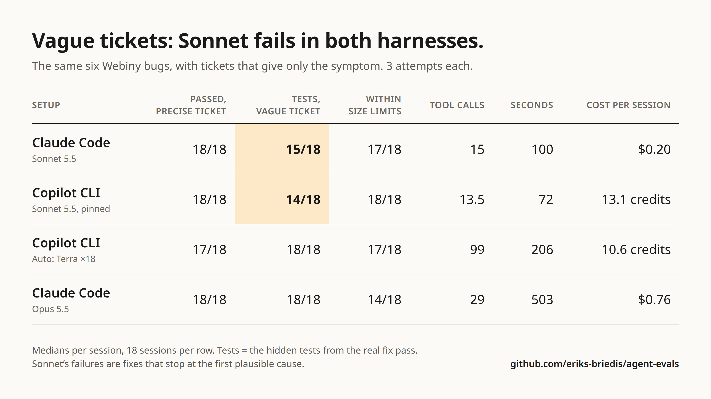
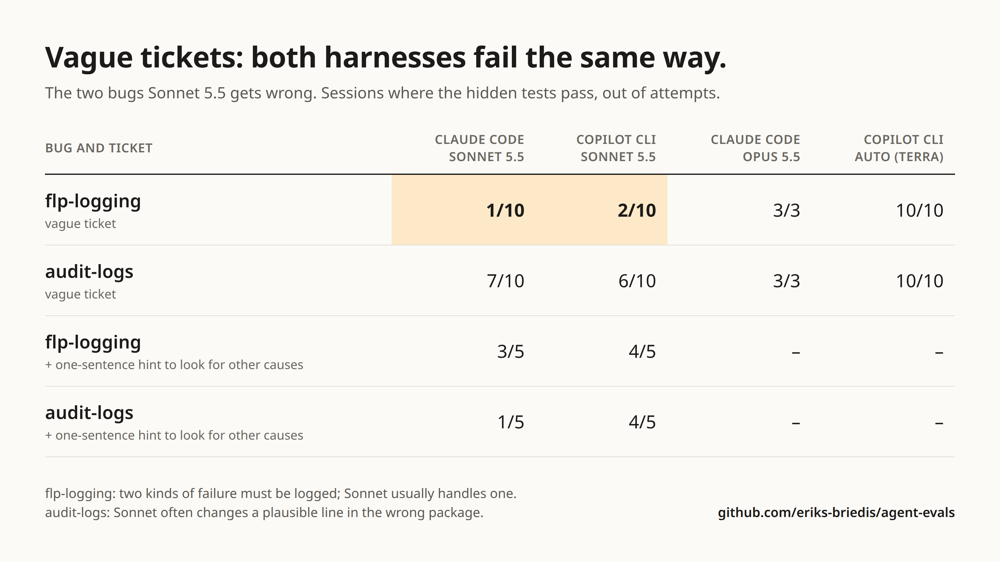

# Experiment: Copilot CLI vs Claude Code on real Webiny bug fixes

By Eriks Briedis, November 2026. 108 agent sessions on six real bug fixes from [webiny/webiny-js](https://github.com/webiny/webiny-js), run with the runner in [`harness/`](harness/README.md). Per-session data: [`sessions.csv`](sessions.csv). The code each agent wrote: [`patches/`](patches/). What the grader recorded: [`grading/`](grading/README.md).

A follow-up of 154 sessions gave the agents the same bugs with [vague tickets](#vague-tickets). Its data is in [`sessions-vague.csv`](sessions-vague.csv).

## Question

Copilot CLI often spends far more effort than a task needs. Is that the harness (prompts, tools, subagents), the model, or the amount of documentation in the repo?

## Method

- **Tasks:** six merged bug-fix PRs. The agent gets the repo at the commit before the fix, already installed and built, plus a ticket describing the symptoms.
- **Grading:** the tests from the real fix are hidden from the agent and run afterwards. A session passes when those tests pass and the change stays within size limits relative to the real fix. Tasks, hidden tests and limits are in [`harness/`](harness/README.md).
- **Size:** source lines the agent changed divided by the lines in the real fix. Tests and markdown are not counted.
- **Context:** all agent instruction files (`AGENTS.md`, `CLAUDE.md`, skills, MCP config, `ai-context/`) were removed from the repo, except in the wiki rows.
- **Runs:** non-interactive, one session per attempt, three attempts per task.
- **Versions:** GitHub Copilot CLI 1.0.109, Claude Code 2.1.322.

## Results without a wiki

Medians per session, 18 sessions per row.

| Row | Agent | Model | Pass | Tool calls | Seconds | Size vs real fix | Sessions touching extra files | Cost per session |
|---|---|---|---|---|---|---|---|---|
| A | Claude Code | Sonnet 5.5 | 18/18 | 8.5 | 62 | 0.76× | 5 | $0.13 |
| B | Copilot CLI | Sonnet 5.5, pinned | 18/18 | 10 | 39 | 0.73× | 2 | 10.1 credits |
| C | Copilot CLI | Auto | 17/18 | 62 | 175 | 0.81× | 10 | 7.2 credits |
| D | Claude Code | Opus 5.5 | 18/18 | 21 | 186 | 1.17× | 10 | $0.66 |

"Extra files" means source files changed that the real fix did not touch. Claude Code cost is the API-equivalent figure the CLI reports; Copilot cost is AI credits.

In row C, Auto picked `gpt-6.1-terra` in 12 sessions, `gpt-6-luna` in 4 and `claude-sonnet-5.5` in 2.

### What it shows

- **Same model, different harness (A vs B):** no meaningful difference in pass rate, effort or change size.
- **Same harness, Auto vs pinned Sonnet (C vs B):** about 6× the tool calls and 4.5× the time for the same pass rate, and five times as many sessions touching files outside the real fix.
- **Bigger model (D vs A):** Opus took three times as long and wrote larger changes, with no gain in pass rate on these tasks.
- **The one failure:** a row C session whose fix was correct but 5.8× the size of the real one (limit 5×).

## Results with a wiki

Each workspace got a `wiki/` folder holding Webiny's own markdown docs from that commit (about 300 pages, 4 MB) and an [`AGENTS.md`](wiki-AGENTS.md) telling the agent to read the relevant pages before changing code. Tickets were unchanged. 18 sessions per row. Attempt 1 of each wiki row was run and published first; attempts 2 and 3 were added afterwards and moved the numbers, mostly down.

| Row | Model | Wiki | Pass | Tool calls | Seconds | Size vs real fix | Credits per session | Wiki pages opened |
|---|---|---|---|---|---|---|---|---|
| C | Auto | no | 17/18 | 62 | 175 | 0.81× | 7.2 | n/a |
| E | Auto | yes | 17/18 | 83 | 198 | 0.94× | 14.0 | 6 (67 KB) |
| B | Sonnet 5.5 | no | 18/18 | 10 | 39 | 0.73× | 10.1 | n/a |
| F | Sonnet 5.5 | yes | 17/18 | 12 | 67.5 | 0.72× | 14.4 | 2 (16.5 KB) |

In row E, Auto picked `gpt-6.1-terra` in 14 sessions and `gpt-6-luna` in 4. It never picked Sonnet, which it did twice in row C.

### What it shows

- **Auto with a wiki:** about 1.9× the credits and 1.3× the tool calls. Time rose only 1.1× and changes were somewhat larger.
- **Sonnet with a wiki:** tool calls and change size barely moved, but credits rose about 43% and sessions took 1.7× as long (67.5 s against 39 s).
- **Pass rate:** no gain. Each wiki row has one failure, both on `audit-logs`: a row E fix that was correct but 5.3× the size of the real one (limit 5×), and a row F fix that was wrong.
- **Instructions:** all 36 sessions followed the instruction file's rule about the final message and none committed, as the ticket required. Nothing here shows the agent following its prompt less.

## Per task

Pass count, then median tool calls.

| Task | A: Claude Code, Sonnet | B: Copilot, Sonnet | C: Copilot, Auto | D: Claude Code, Opus | E: Copilot, Auto, wiki | F: Copilot, Sonnet, wiki |
|---|---|---|---|---|---|---|
| audit-logs | 3/3, 9 | 3/3, 10 | 2/3, 116 | 3/3, 20 | 2/3, 115 | 2/3, 13 |
| os-registries | 3/3, 13 | 3/3, 15 | 3/3, 47 | 3/3, 16 | 3/3, 79 | 3/3, 14 |
| flp-logging | 3/3, 7 | 3/3, 9 | 3/3, 54 | 3/3, 21 | 3/3, 77 | 3/3, 7 |
| model-cache | 3/3, 17 | 3/3, 11 | 3/3, 83 | 3/3, 33 | 3/3, 114 | 3/3, 16 |
| sql-leak | 3/3, 5 | 3/3, 10 | 3/3, 77 | 3/3, 21 | 3/3, 69 | 3/3, 12 |
| tenant-leak | 3/3, 6 | 3/3, 5 | 3/3, 43 | 3/3, 22 | 3/3, 65 | 3/3, 9 |

The images are generated from `sessions.csv` and `sessions-vague.csv` by [`make-images.mjs`](make-images.mjs).

## Vague tickets

Every row above passes 17 or 18 of 18, so the tasks as first written separate nothing on pass rate. The tickets were the likely reason: they name the affected class, the failing case or the expected behaviour. This follow-up keeps the six bugs and rewrites each ticket as a user would report it, with symptoms only. The full texts are [below](#vague-ticket-texts).

- **Same:** starting commits, repo notes, agents, versions and size limits. No wiki.
- **Hidden tests:** assertions for requirements that only the precise ticket stated were removed, and one test was rewritten after review. See [Hidden tests and review](#hidden-tests-and-review).
- **Limits:** unchanged, except `sql-leak`, which allows 6 source files instead of 5.
- **Sessions:** 154, in rows G to N.

### All six tasks, three attempts each

Medians per session, 18 sessions per row. "Tests" is sessions where the hidden tests pass. "In scope" is sessions within the size and file limits. A session passes when both hold.

| Row | Agent | Model | Tests | In scope | Pass | Pass, precise ticket | Tool calls | Seconds | Cost per session |
|---|---|---|---|---|---|---|---|---|---|
| G | Claude Code | Sonnet 5.5 | 15/18 | 17/18 | 15/18 | 18/18 | 15 | 100 | $0.20 |
| H | Copilot CLI | Sonnet 5.5, pinned | 14/18 | 18/18 | 14/18 | 18/18 | 13.5 | 71.5 | 13.1 credits |
| I | Copilot CLI | Auto | 18/18 | 17/18 | 17/18 | 17/18 | 99 | 205.5 | 10.6 credits |
| M | Claude Code | Opus 5.5 | 18/18 | 14/18 | 14/18 | 18/18 | 29 | 502.5 | $0.76 |

In row I, Auto picked `gpt-6.1-terra` in all 18 sessions. One row M session hit the 30-minute timeout with a passing fix already written.

Hidden tests passed per task:

| Task | G: Claude Code, Sonnet | H: Copilot, Sonnet | I: Copilot, Auto | M: Claude Code, Opus |
|---|---|---|---|---|
| audit-logs | 3/3 | 1/3 | 3/3 | 3/3 |
| os-registries | 3/3 | 3/3 | 3/3 | 3/3 |
| flp-logging | 0/3 | 1/3 | 3/3 | 3/3 |
| model-cache | 3/3 | 3/3 | 3/3 | 3/3 |
| sql-leak | 3/3 | 3/3 | 3/3 | 3/3 |
| tenant-leak | 3/3 | 3/3 | 3/3 | 3/3 |

All seven test failures in rows G and H are on two tasks. Reading the patches:

- **`flp-logging`, 5 failures:** the fix logs the error when triggering the background task throws, but not when the trigger returns a failed `Result`. The second case is still dropped silently.
- **`audit-logs`, 2 failures:** a one-line change to the table name in the DynamoDB storage package. The real cause is elsewhere and the audit log stays empty.

Row M's four failures are all scope: three `flp-logging` fixes that changed 7 to 9 source files (limit 6) and one `sql-leak` fix that changed 7 (limit 6).

### The two tasks that fail, more attempts

`flp-logging` and `audit-logs` were run again: the plain rows up to 10 attempts per task (row M stays at 3), and four new rows with 5 attempts per task, each changing one thing.

- **Rows J and L, hint:** one sentence added to the end of the ticket: "Before you finish, check whether the same problem can happen in other ways or for other reasons, not only the first one you find."
- **Row K:** `gpt-6.1-terra` pinned, the model Auto picked in 31 of the 32 row I sessions.
- **Row N, spec first:** the text of the [preflight-spec](https://github.com/eriks-briedis/claude-flowkit/blob/main/skills/preflight-spec/SKILL.md) skill added to the ticket. It makes the agent write a goal, non-goals, acceptance criteria and a verification target before editing. Four things were added for this run: an instruction to proceed without waiting for a user, "list every code path that can produce the symptom … one acceptance criterion per path", "write a failing test for each acceptance criterion before changing production code", and a final step that checks the diff against the criteria. The exact text is in [`harness/tasks/webiny-flp-logging-vague-preflight/task.json`](harness/tasks/webiny-flp-logging-vague-preflight/task.json).

Tests passed, then sessions that passed overall, then median cost per session.

| Row | Agent | Model | Ticket | flp-logging | audit-logs |
|---|---|---|---|---|---|
| G | Claude Code | Sonnet 5.5 | vague | 1/10, 1/10, $0.18 | 7/10, 7/10, $0.34 |
| L | Claude Code | Sonnet 5.5 | vague + hint | 3/5, 0/5, $0.23 | 1/5, 0/5, $0.43 |
| N | Claude Code | Sonnet 5.5 | vague + spec first | 5/5, 1/5, $0.45 | 4/5, 4/5, $0.36 |
| M | Claude Code | Opus 5.5 | vague | 3/3, 0/3, $1.59 | 3/3, 3/3, $0.70 |
| H | Copilot CLI | Sonnet 5.5, pinned | vague | 2/10, 2/10, 14.0 credits | 6/10, 6/10, 25.8 credits |
| J | Copilot CLI | Sonnet 5.5, pinned | vague + hint | 4/5, 2/5, 18.2 credits | 4/5, 1/5, 49.5 credits |
| I | Copilot CLI | Auto | vague | 10/10, 10/10, 11.3 credits | 10/10, 7/10, 11.8 credits |
| K | Copilot CLI | `gpt-6.1-terra`, pinned | vague | 5/5, 5/5, 14.7 credits | 5/5, 5/5, 13.4 credits |

Median tool calls on `flp-logging` and `audit-logs`: row G 10.5 and 21, row L 14 and 23, row N 24 and 19, row M 43 and 28, row H 11 and 19, row J 14 and 34, row I 93 and 107, row K 75 and 88.

### What it shows

- **Precise tickets hid the failures.** On the same bugs, Sonnet went from 18/18 to 15/18 (Claude Code) and 14/18 (Copilot CLI) once the ticket gave only symptoms.
- **Sonnet stopped at the first plausible cause, in both harnesses.** Over 10 attempts it passed the hidden tests on `flp-logging` in 1 (Claude Code) and 2 (Copilot CLI), and on `audit-logs` in 7 and 6. The harness makes no visible difference.
- **Opus and `gpt-6.1-terra` did not stop early.** Opus passed the hidden tests in all 18 sessions, Auto in all 32 and pinned `gpt-6.1-terra` in all 10. Opus cost about 4× Sonnet per session and took 5× as long; `gpt-6.1-terra` used about 5 to 8 times Sonnet's tool calls.
- **It is the model, not Auto's routing.** Pinning the model Auto usually picks gave the same result as Auto.
- **A spec-first procedure brought Sonnet to Opus's level on `flp-logging`.** With row N's prompt Sonnet passed the hidden tests in 5 of 5 sessions against 1 of 10 without it, at $0.45 per session against Opus's $1.59.
- **It did not fix the wrong diagnosis on `audit-logs`.** 4 of 5 against 7 of 10 without it. The one failure changed the table name again and wrote a test for that theory, which passed. A test written from a wrong diagnosis confirms it.
- **One sentence of hint is weaker and less stable.** It helped on `flp-logging` in both harnesses (7 of 10 against 3 of 20 without it). On `audit-logs` it gave 4 of 5 in the Copilot CLI and 1 of 5 in Claude Code.
- **Finding more causes widens the change.** Every row that found the second `flp-logging` cause mostly went over a size or file limit there: row L (5 of 5), row N (4 of 5), row J (3 of 5) and Opus (3 of 3). The real fix changes three files; these fixes also change the three task files or add a helper. Only `gpt-6.1-terra` found both causes and stayed within the limit.
- **Auto still writes oversized changes.** 3 of its 10 `audit-logs` fixes pass the tests but are 8.3×, 14.0× and 15.3× the size of the real fix (limit 5×).

### Hidden tests and review

The tests from the real fix check some things only the precise ticket asked for. For the vague tasks those assertions were removed, each marked with an `// eval-vague:` comment:

| Task | Removed |
|---|---|
| os-registries | Isolation between requests. |
| sql-leak | The two concurrency tests and the requirement that the factory returns the same object. |
| tenant-leak | Rejecting `setTenant()` inside a temporary switch. |
| flp-logging | The folder id in the log entry. |

`audit-logs` and `model-cache` use the tests unchanged.

Every session that failed the hidden tests in the three-attempt rows (G, H, I, M) was then read:

- **`sql-leak`, 5 sessions, test at fault.** Four fixes in rows G and H kept the leaking registry only when running under a test runner, which removes the leak in production. One fix in row M replaced it with weak references. The hidden test counted the registry as a plain list while running under the test runner, so it failed all five. It now hides the test-runner environment variables while it measures and counts only managers held by strong references. All twelve `sql-leak` sessions were re-graded from their saved patches and pass the tests.
- **`sql-leak` file limit.** Two sessions then failed only for changing 6 source files against a limit of 5: one for a comment edit, one for a small shared helper. The limit for this task was raised to 6.
- **`flp-logging` and `audit-logs`, 7 sessions, fix at fault.** Incomplete or wrong, as described above. Tests unchanged.

Failures in the later sessions (attempts 4 to 10 and rows J, K, L and N) were not all read one by one.

### Limits of the follow-up

- **Sample:** three attempts per task for four of the six tasks, and 5 attempts for the rows that change the prompt. The `flp-logging` results are the only ones large enough to rely on.
- **Two tasks:** the hint and the spec-first prompt were tested on `flp-logging` and `audit-logs` only, and the spec-first prompt in Claude Code only.
- **Scope limits against wider fixes:** a fix that covers more causes than the real one is counted out of scope. Whether those wider changes are better or worse than the real fix was not judged.
- **Review by the author:** the judgement that a failing fix is wrong, or that a test was unfair, is one reader's. The patches and test output are published so it can be checked.
- **Patches left out:** the `model-cache` patches of rows I and M (six sessions) change a Webiny package that is not MIT-licensed. Their numbers are in `sessions-vague.csv`.

### Vague ticket texts

| Task | Ticket given to the agent |
|---|---|
| audit-logs | The Audit logs page in Admin is always empty. Our editors create and update content every day, and people change files and user roles too, but none of it shows up in the list. It used to work; we noticed a few weeks ago that it had stopped. Find out why and fix it. |
| os-registries | We have an extension that adds a custom OpenSearch query operator, and another one that adds its own index. Since the upgrade both are ignored: searching with the custom operator behaves as if it did not exist, and the custom index is never used. The built-in operators still work. Nothing is logged. Find out why and fix it. |
| sql-leak | On our self-hosted installation with the SQL database, the API server's memory use keeps growing while it serves requests, until we restart it. It grows with the number of requests, not with the amount of data. Find the cause and fix it. |
| model-cache | The GraphQL schema is not always the same. For requests made without logging in, the tenant's `extensions` field is typed as plain `JSON`; for logged-in admins it is the typed input (`Tenant_ExtensionsInput`). It should not depend on who is asking. It also makes cold starts slower for us, because the schema gets built twice. Find the cause and fix it. |
| tenant-leak | In our multi-tenant project, a GraphQL query now and then returns data from a different tenant, usually the parent tenant. It is intermittent and we cannot reproduce it reliably. It seems to happen on queries that ask for several things at once, for example the user's profile or permissions together with other data; the same fields queried one at a time are always right. Find the cause and fix it. |
| flp-logging | Every so often a folder ends up with wrong permissions after it is created, changed or deleted: a new folder has no permission record, or a folder and its subfolders keep their old permissions. When it happens there is nothing in the logs, so we cannot tell what went wrong. The folder change itself always goes through. Make it possible to see from the logs when and why this happens. |

Every ticket was followed by the same repo notes as before.

## Limits

- **Ceiling:** every row A to F passes 17 or 18 of 18, so pass rate separates nothing there. The differences are in effort, size and cost. The [vague tickets](#vague-tickets) remove the ceiling.
- **Sample:** three attempts per task. Only large differences mean anything. The wiki rows show why: their first attempt alone gave 2.5× the time for Auto, all three give 1.1×.
- **Tickets:** written for this experiment from the PR descriptions. They are more precise than most real tickets, and some name the affected class or package.
- **Reference fixes:** the real Webiny fixes were written with Claude Code, which may favour Claude models on similarity to the reference.
- **Re-grading:** one Claude Code session was first marked failed because the test database port was busy during grading. It passed when re-graded from its saved patch.
- **Hidden tests:** three of the real test files asserted on exact error text, exact log text or an exact instance count. Those assertions were loosened so that a different correct fix is not failed. All sessions were graded with the same tests.
- **Session shape:** single short sessions. Long interactive sessions with context compaction are not covered.
- **Auto is not fixed:** which model Auto picks depends on the subscription and the day.

## Tasks

| Task | PR | Ticket given to the agent |
|---|---|---|
| audit-logs | [#5762](https://github.com/webiny/webiny-js/pull/5762) | The Audit logs page in Admin loads, but the list is always empty: nothing has been written to the audit log since mid-July, whatever users do (creating or updating CMS entries, file manager changes, security changes). The server prints `No AuditLogs defined.` when these actions happen. Find out why audit logs are no longer written and fix it. |
| os-registries | [#5980](https://github.com/webiny/webiny-js/pull/5980) | Custom OpenSearch query-builder operators and indexes registered by an extension are silently ignored: `OpenSearchQueryBuilderOperatorRegistry` and `OpenSearchIndexRegistry` only ever contain the built-in ones. Extensions register theirs per request. An operator or index registered in a request's container must show up in that request's registry, must not show up in another request's or in the root's, and the built-in ones must stay available everywhere. |
| sql-leak | [#5926](https://github.com/webiny/webiny-js/pull/5926) | On the self-hosted SQL setup the API server's memory grows with every request, and every request checks again whether its database tables exist. Find the cause in the SQL core storage (`packages/api-core-sql`) and fix it. After the fix, serving many requests must not create additional `TableManager` instances: asking the storage operations factory repeatedly must give back the same storage operations. The shared instance must be safe under concurrency: concurrent first use of the same table, including by two managers racing to create it, must succeed. |
| model-cache | [#5912](https://github.com/webiny/webiny-js/pull/5912) | The GraphQL schema the API builds depends on who made the first call in a request. When a permission-checked read of content models by an anonymous or low-privilege identity happens first, later code in the same request that runs under `withoutAuthorization` (for example building the tenant schema, which needs the `wbyTenant` model) gets a model list with code-defined models missing. Reads under `withoutAuthorization` must always see every model of the tenant, whatever ran earlier in the request, and permission-checked use cases must keep denying access exactly as before. |
| tenant-leak | [#6185](https://github.com/webiny/webiny-js/pull/6185) | In multi-tenant projects a GraphQL query sometimes returns data from the wrong tenant. It happens when one field of a query temporarily switches tenant through `TenantContext.withTenant()`, `withRootTenant()` or `withEachTenant()` (for example to load inherited permissions or a profile from the parent tenant) while a sibling field of the same query is still resolving: the sibling reads the switched tenant instead of the request's own. Fix the leak so a temporary tenant switch is visible only to the code running inside its callback. Calling `setTenant()` inside such a callback must be rejected with an error and leave the request's tenant unchanged. |
| flp-logging | [#5983](https://github.com/webiny/webiny-js/pull/5983) | When a folder is created, updated or deleted, a background task is triggered to write the folder's FLP (folder level permission) records. If triggering that task fails, either with a failed `Result` from `TaskService.trigger()` or with a thrown error, the failure is dropped and nothing is logged, leaving folders with missing or stale permissions and no trace of why. Make both kinds of failure visible through the DI `Logger`, including the folder id. The folder change itself must still succeed. |

Every ticket was followed by the same repo notes: how to run Yarn, tests, type checks and builds in the prepared checkout, and "Do not commit or push anything."

## Reproduce on your own repo

Use [`evals.mjs`](../../README.md) in this repo. It is the generalised version of the runner used here and runs the same kind of replay on any git repo: pick fix commits, describe the problem, define the setups to compare.
